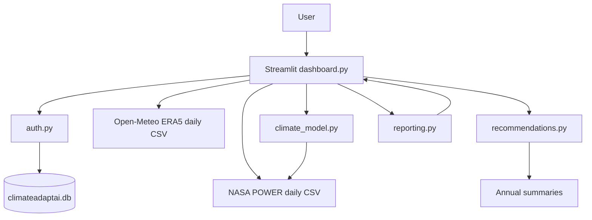

# Architecture

## Component view



## Runtime flow

1. The dashboard initializes the local SQLite account table and shows the
   login/registration screen to unauthenticated visitors.
2. After login, the sidebar provides city selection, user-facing pages, and
   the light/dark appearance toggle.
3. Dashboard pages load the included daily and precomputed annual/monthly
   climate files, filter results to the selected city, and show readable
   column labels.
4. The **Climate Predictions** page trains and caches the city-specific
   evaluation/forecast run. It uses NASA POWER data and shows the 2024
   holdout comparison and historical next-day estimate.
5. Climate-history and simulation guidance comes from explicit rules in
   `recommendations.py`.
6. Each page with reportable data passes its result tables and explanatory
   notes to `reporting.py`, which creates CSV and PDF downloads. CSV includes
   all rows; PDF tables show at most the first 100 rows each.

## Main modules and data

| Component | Responsibility |
|---|---|
| `dashboard.py` | Authentication gate, navigation, climate pages, simulations, report controls |
| `auth.py` | Username/email validation and password hashing/verification |
| `climate_model.py` | Per-city temperature/rainfall regressors and chronological evaluation |
| `recommendations.py` | Trend-based and simulation-based planning suggestions |
| `reporting.py` | Friendly labels, CSV export, PDF report generation |
| `data/` | Daily source files and precomputed annual/monthly summaries |
| `tests/` | `unittest` and Streamlit `AppTest` coverage for models, recommendations, reports, and user workflows |

The developer-only database-information page is hidden by default. To enable
it for local development in PowerShell:

```powershell
$env:CLIMATEADAPTAI_DEVELOPER_MODE = "1"
streamlit run dashboard.py
```

This setting does not change the normal user navigation.
