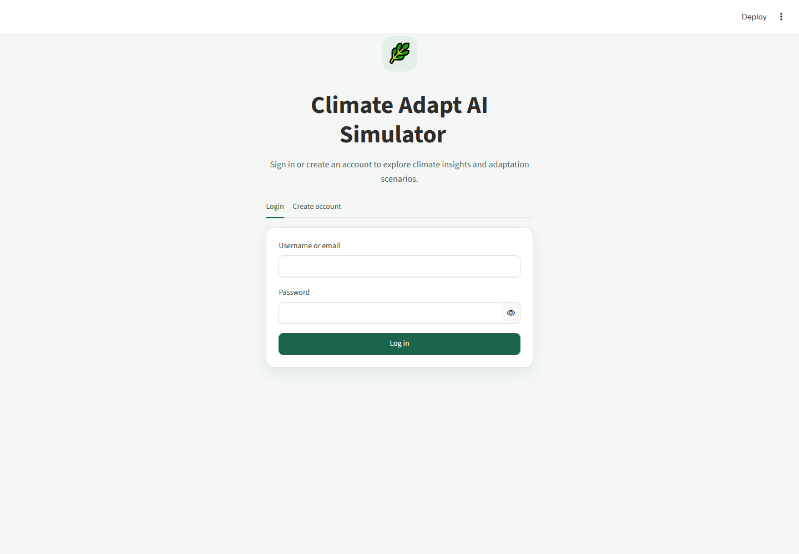
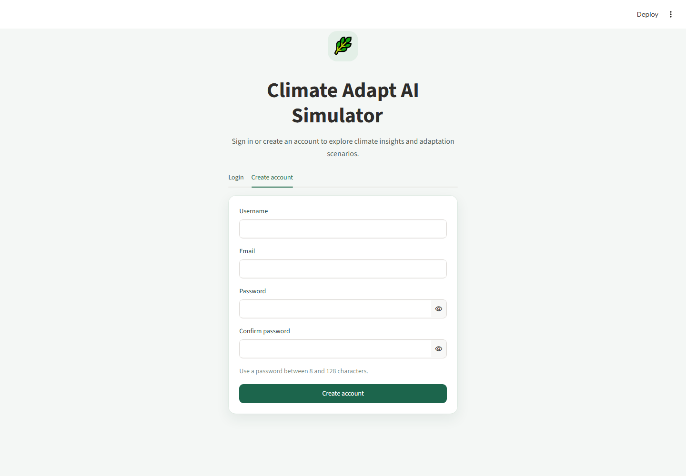
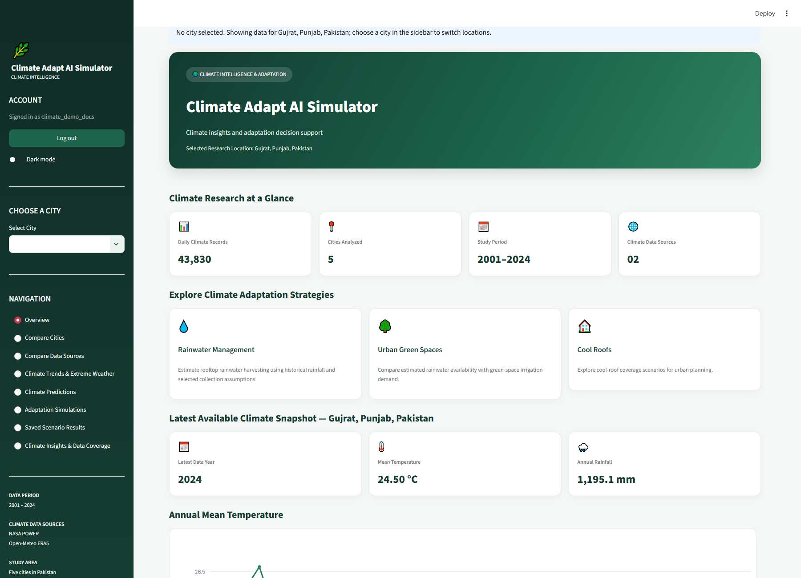
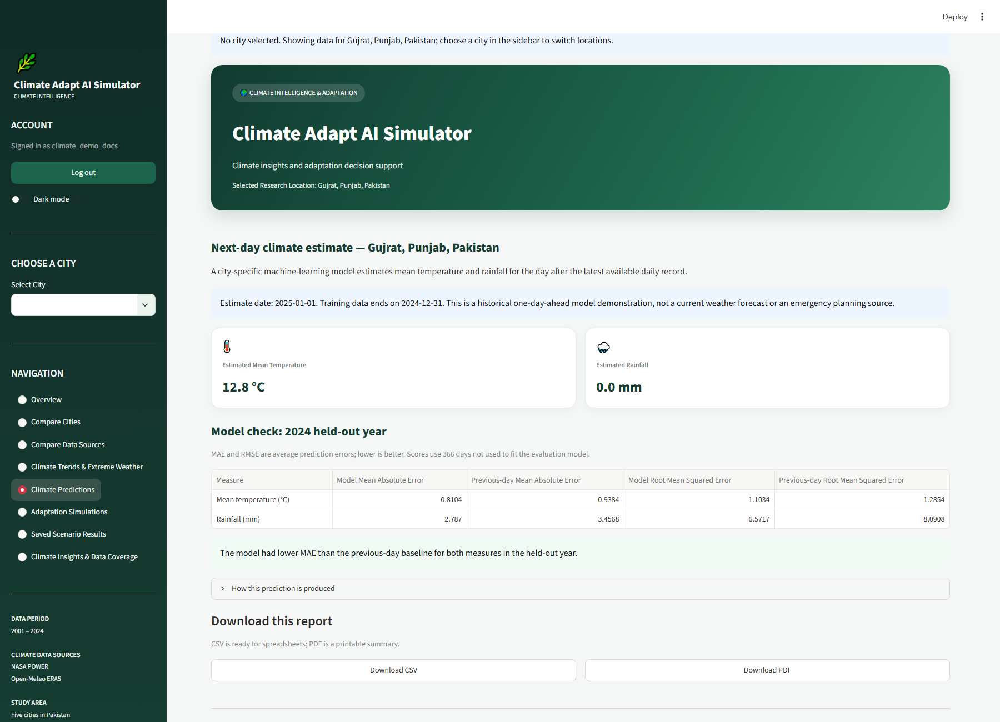

# Climate Adapt AI Simulator — Project Report

## Abstract

Climate Adapt AI Simulator is a Streamlit research prototype for exploring
historical temperature and rainfall across five Pakistani cities and comparing
simple adaptation scenarios. It combines source comparisons, climate-trend
summaries, a city-specific machine-learning demonstration for next-day mean
temperature and rainfall, transparent rule-based recommendations, and
downloadable reports.

The data ends in 2024. The model's displayed estimate is therefore for
2025-01-01 and is explicitly not presented as a current weather forecast.
Simulation results are simplified planning estimates and not engineering
predictions.

## Problem and objectives

Local planners and students need a clear way to inspect climate history and
compare basic adaptation options without relying on unexplained technical
tables. The project aims to:

1. Present historical climate data in a city-focused interface.
2. Compare NASA POWER and Open-Meteo ERA5 records.
3. Implement and chronologically evaluate next-day temperature and rainfall
   models against a simple baseline.
4. Translate historical trend and scenario outcomes into practical,
   caveated suggestions.
5. Let signed-in users export page results as CSV or PDF.

## Scope and implementation

The study includes Gujranwala, Gujrat, Islamabad, Lahore, and Rawalpindi for
2001–2024. The app includes Overview, city/source comparison, climate trends,
Climate Predictions, Adaptation Simulations, Saved Scenario Results, and
Climate Insights & Data Coverage pages. User accounts are stored in the local
SQLite database. Public pages use readable labels; the database-information
page is reserved for developer mode.

The two daily source files contain 43,830 records each (8,766 per city).
Within each file, the checked data has no missing cells or duplicate
city/date rows. All NASA POWER quality flags are `OK`. Gridded climate
estimates are not direct local weather-station measurements.

## Model and evaluation

The model trains separate HistGradientBoosting regressors for each city and
measure. Inputs include current-day values, trailing seven-day summaries, and
seasonal calendar features. Rainfall is modeled in `log1p` space. Evaluation
uses targets before 2024 for training and all 366 target days in 2024 for the
chronological holdout, with 8,393 training examples per city. The comparator
is a previous-day persistence baseline.

### 2024 held-out results

Errors are in °C for temperature and mm for rainfall. Each cell is
**model / previous-day baseline**.

| City | Temperature MAE | Temperature RMSE | Rainfall MAE | Rainfall RMSE |
|---|---:|---:|---:|---:|
| Gujranwala | 0.773 / 0.879 | 1.033 / 1.200 | 2.398 / 3.324 | 6.327 / 7.821 |
| Gujrat | 0.810 / 0.938 | 1.103 / 1.285 | 2.787 / 3.457 | 6.572 / 8.091 |
| Islamabad | 0.784 / 0.884 | 1.049 / 1.191 | 4.612 / 6.140 | 18.836 / 23.930 |
| Lahore | 0.763 / 0.862 | 1.026 / 1.165 | 2.179 / 2.851 | 6.654 / 8.012 |
| Rawalpindi | 0.784 / 0.884 | 1.049 / 1.191 | 4.612 / 6.140 | 18.836 / 23.930 |

On the 2024 historical holdout, each city's model has lower MAE and RMSE than
the persistence baseline for both measures. The model was also checked on
separate 2022 and 2023 holdouts:

| Holdout year | Training examples / test days per city | Temperature MAE (model / baseline) | Temperature RMSE (model / baseline) | Rainfall MAE (model / baseline) | Rainfall RMSE (model / baseline) |
|---|---:|---:|---:|---:|---:|
| 2022 | 7,663 / 365 | 0.804 / 0.900 | 1.108 / 1.232 | 3.164 / 4.160 | 8.124 / 9.661 |
| 2023 | 8,028 / 365 | 0.862 / 0.959 | 1.180 / 1.336 | 3.221 / 4.345 | 8.422 / 10.653 |
| 2024 | 8,393 / 366 | 0.783 / 0.889 | 1.052 / 1.206 | 3.318 / 4.382 | 11.445 / 14.357 |

The additional-year table reports the arithmetic mean of the five
city-specific scores for each metric, not pooled row-level errors. For every
city and each of the three holdout years, model MAE and RMSE were lower than
the previous-day baseline for both measures. This is evidence about these
retrospective periods in the included dataset; it is not proof of future
forecast skill.

The Islamabad and Rawalpindi NASA POWER series are identical in the included
data, which explains their identical scores and means their results are not
independent. Open-Meteo ERA5 has distinct series for those cities.

## Recommendations and simulations

Trend suggestions compare the first and most recent five-year average. A mean
temperature rise of 0.5 °C or at least five additional annual days at or above
35 °C prompts cooling/shade guidance. Rainfall changes of 15% or more prompt
water-supply or drainage advice. Results are framed as planning guidance and
include a historical-data caveat.

Simulation recommendations are based on transparent calculation outcomes:
rainwater collection and green-space irrigation use rainfall, area, and
user-set assumptions; cool-roof results show coverage area only. They do not
predict project costs, indoor cooling, energy savings, or real-world
performance.

## User interface and reports

Users must register with a username, email, and password and then sign in.
They can select a city, switch light/dark appearance, and navigate to public
climate pages. CSV and PDF report controls are provided wherever a page has
reportable results. CSV retains all rows; PDF tables are capped at 100 rows
per section and include explanatory notes where relevant.

## Screenshots

### Login

### Account registration

### Overview

### Climate prediction and model evaluation

## Limitations and future work

- Historical data ends on 2024-12-31; the model is not a live forecast.
- NASA POWER Islamabad and Rawalpindi daily records are identical in the
  bundled file. Investigate spatial resolution and source extraction before
  interpreting those cities independently.
- Gridded datasets may not represent street- or neighborhood-level weather.
- The model has three retrospective holdout years, but no uncertainty
  intervals or external-station validation.
- The adaptation calculators use simplified annual totals and do not model
  seasonal water availability, infrastructure, costs, or measured outcomes.
- Trend and scenario suggestions are rules, not a generative AI assistant or
  a separately trained recommendation model.
- Future work should refresh/verify data, investigate the city-series
  duplication, validate against local stations, evaluate older or rolling
  holdout periods, quantify uncertainty, and test the calculators with local
  engineering assumptions.

## Conclusion

The project now combines user-facing historical climate analysis, a tested
machine-learning demonstration with a chronological baseline comparison,
practical but caveated adaptation suggestions, and downloadable CSV/PDF
reports. The results are reproducible for the included data and should be
treated as educational planning support rather than operational forecasts.
